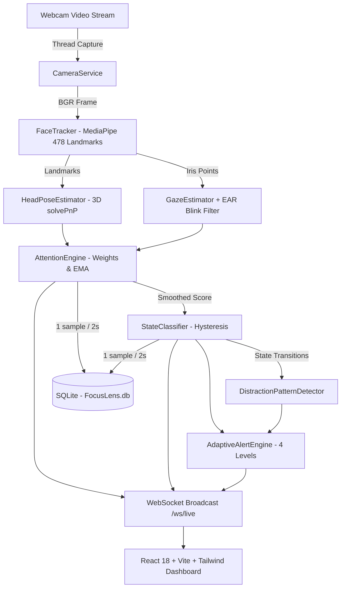

# FocusLens 👁️⚡

> **A Privacy-First Visual Attention & Engagement Telemetry Engine for Deep Focus Sessions**

[](https://fastapi.tiangolo.com)
[](https://react.dev)
[](https://www.typescriptlang.org/)
[](https://opencv.org)
[](#privacy-guarantee)

FocusLens is a privacy-preserving productivity app that uses a webcam to estimate whether a user is visually engaged with their screen during a focus session. Unlike traditional Pomodoro timers that blindly count down minutes, FocusLens continuously measures visual engagement over time, detects distraction patterns, and adapts its feedback gently so it never annoys you.

---

## 🔒 Privacy Guarantee
> **"Your camera stays local. FocusLens stores attention metrics, not your video."**

- **Zero Video Persistence:** Raw webcam frames are processed strictly in volatile RAM for $1/15^{\text{th}}$ of a second during feature extraction. Frames are **NEVER** saved to disk, NEVER written to a database, and NEVER transmitted over a network.
- **Derived Metrics Only:** Only downsampled numerical metrics (timestamp, engagement score $0.0-1.0$, discrete state, head yaw/pitch, and gaze ratios) are saved in your local SQLite database.
- **Optional Local Preview:** The live camera preview in the UI is disabled by default, strictly opt-in, downscaled, and streamed exclusively over localhost.
- **Instant Data Wipe:** A prominent "Delete All My Data" button allows you to permanently erase all stored telemetry with a single click.
- **Hardware Control:** The webcam hardware is immediately released whenever a session is paused or ended.

---

## ⚠️ Scientific Honesty & Limitations Disclosure
FocusLens estimates **visual engagement** (face presence, head orientation, eye gaze direction, and posture stability). It **cannot know true neurological concentration, cognitive depth, or mental comprehension**. Environmental factors such as room lighting, eyeglasses reflections, camera mounting angles, and multi-monitor setups will naturally influence readings.

---

## ✨ Key Features

1. **Live Visual Attention Meter:** Large circular gauge with percentage, accessible color-coded state chips (`Deep Engagement`, `Engaged`, `Glancing Away`, `Away from Screen`), and live posture telemetry.
2. **Focus Session Timer:** Countdown timer with pause/resume/end controls, progress ring, and automatic mode adaptations.
3. **Adaptive Alert Engine (4 Progressive Levels):**
   - **Level 1 (<10s):** Grace period (silent, no action).
   - **Level 2 (30s):** Passive subtle notice ("Attention dropped", no intrusive modal).
   - **Level 3 (2m):** Gentle notification ("You've been away for a while").
   - **Level 4 (3+ drops in 10m):** Adaptive prompt ("Your attention has been fluctuating. Pause the session?") with `[Pause Session]` and `[Continue]` action buttons.
4. **Smart Break Suggestions:** Detects long sustained focus stretches ($\ge 25\text{ mins}$) followed by rising attention drops and respectfully suggests a short eye stretch.
5. **Interactive Heatmap & Timeline:** Color-coded interval blocks with click-to-inspect detail overlays, accompanied by a continuous Recharts attention area chart.
6. **Distraction Pattern Classification:** Automatically categorizes session behavior into patterns such as *Frequent Short Drops* (e.g. checking phone notifications) vs. *Prolonged Absence* (left desk) vs. *High Sustained Focus*.
7. **Preset Modes:**
   - **Coding:** Tolerates wider head yaw ($\pm 28^\circ$) for glancing at notes.
   - **Study:** Balanced sensitivity.
   - **Reading:** Tolerates downward pitch ($\pm 32^\circ$) for reading low on the screen.
   - **Meeting:** Prioritizes face presence and orientation.
8. **5-Point Posture & Gaze Calibration Wizard:** Guides users through looking at the center and screen corners to establish personal offsets.
9. **AI Session Coach & Export:** Generates plain-language session summaries from aggregated statistics and exports data to JSON / CSV.
10. **Full Simulation Mode:** Toggleable `FOCUSLENS_SIMULATE=1` generates realistic synthetic attention streams for demos, testing, and CI without requiring physical webcam hardware.

---

## 🏗️ System Architecture



---

## 🛠️ Tech Stack

- **Frontend:** React 18, Vite, TypeScript, Tailwind CSS, Recharts, Lucide Icons, Vitest.
- **Backend:** Python 3.11, FastAPI, Uvicorn, WebSockets, Pydantic v2, SQLAlchemy 2.x, aiosqlite, Pytest.
- **Vision:** OpenCV (`cv2`), MediaPipe Face Mesh (with Iris landmark refinement), NumPy.
- **Database:** SQLite (persisting derived metrics only, downsampled to 1 row per 2 seconds).

---

## 🚀 Quick Start & Installation

### Prerequisites
- Python 3.10+ (tested on Python 3.11)
- Node.js 18+ and npm

### 1. Clone & Set Up
```bash
git clone https://github.com/MohammedRiyaz225/Unified-Drug-Discovery.git FocusLens
cd FocusLens
```

### 2. Backend Setup
```bash
cd backend
python -m venv .venv

# On Windows:
.venv\Scripts\activate
# On macOS / Linux:
# source .venv/bin/activate

pip install -r requirements.txt
```

### 3. Frontend Setup
```bash
cd ../frontend
npm install
```

### 4. Running the App

**Start Backend:**
```bash
# In backend/ (with virtualenv activated)
uvicorn app.main:app --host 127.0.0.1 --port 8000 --reload
```

**Start Frontend:**
```bash
# In frontend/
npm run dev
```
Open **http://localhost:5173** in your browser to launch FocusLens!

---

## 🧪 Testing

### Backend Unit Tests (Pure Logic, No Camera Required)
```bash
cd backend
.venv/Scripts/pytest -v tests/
```
*Runs 16 comprehensive unit tests covering Attention math, EMA smoothing, State hysteresis, 4-tier alert sequences, distraction pattern detection, and database privacy zero-persistence verification.*

### Frontend Tests
```bash
cd frontend
npx vitest run
```

---

## ⚙️ Configuration Reference

Configuration can be set via environment variables or the UI Settings page:

| Variable | Default | Description |
|---|---|---|
| `FOCUSLENS_SIMULATE` | `false` | When `true`, generates synthetic attention telemetry without webcam |
| `FOCUSLENS_CAMERA_INDEX` | `0` | System webcam hardware index |
| `FOCUSLENS_TARGET_FPS` | `15` | Capture and inference target frame rate |
| `FOCUSLENS_WEIGHT_FACE` | `0.25` | Relative weight for face mesh presence |
| `FOCUSLENS_WEIGHT_HEAD` | `0.30` | Relative weight for calibrated head orientation |
| `FOCUSLENS_WEIGHT_EYES` | `0.30` | Relative weight for iris gaze direction |
| `FOCUSLENS_WEIGHT_STABILITY` | `0.15` | Relative weight for low pose variance stability |
| `FOCUSLENS_EMA_ALPHA` | `0.35` | Exponential moving average smoothing factor |
| `FOCUSLENS_STATE_HYSTERESIS_FRAMES`| `5` | Consecutive frames required to commit a state transition |
| `FOCUSLENS_DB_DOWNSAMPLE_INTERVAL_SEC` | `2.0` | Seconds between telemetry database writes |

---

## 🗺️ Roadmap
- [x] On-device MediaPipe 478 landmark & iris extraction
- [x] 3D solvePnP head pose estimation with calibration offsets
- [x] EAR blink filtering to prevent blink penalties
- [x] 4-tier progressive adaptive alert engine with cooldowns
- [x] Session manager with downsampled SQLite persistence
- [x] Real-time WebSocket telemetry broadcast
- [x] Interactive heatmap & Recharts timeline
- [x] One-click permanent data wipe
- [ ] Multi-screen gaze offset support
- [ ] Desktop packaging (Tauri / Electron)

---

## 💼 Portfolio Summary
**FocusLens** is a full-stack, privacy-first computer vision productivity engine engineered with FastAPI, WebSockets, MediaPipe, OpenCV, React 18, TypeScript, and Tailwind CSS. It introduces an adaptive visual engagement model with temporal hysteresis, blink-robust gaze estimation, and 4-tier progressive alert feedback. Architected with strict zero-persistence privacy constraints, all video frames are processed exclusively in volatile CPU memory and discarded in under 70ms, ensuring complete on-device privacy with zero external telemetry transmission.
