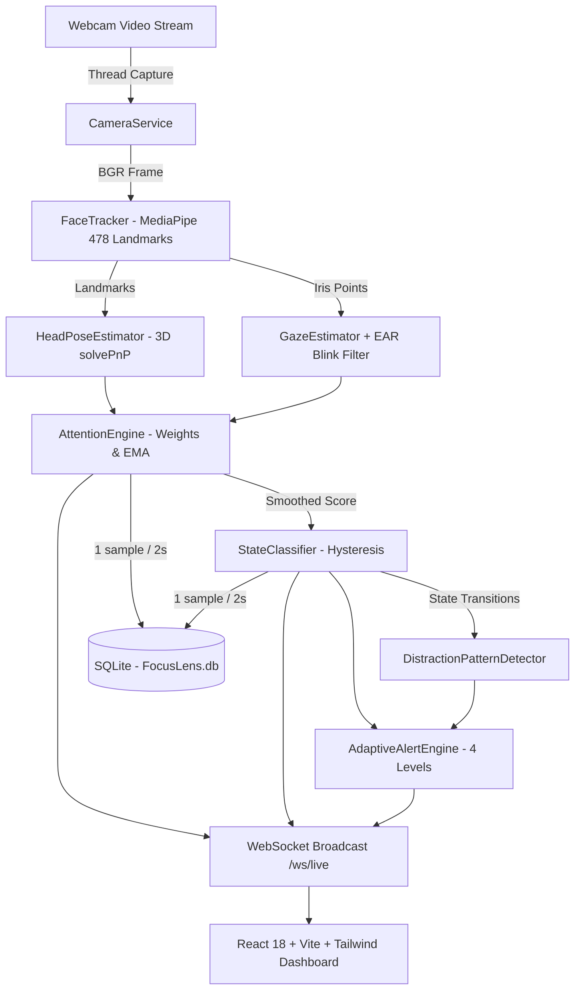

# FocusLens System Architecture

## Architecture Diagram

## Backend Pipeline
1. **CameraService (`app/vision/camera.py`):** Runs a dedicated background daemon thread reading frames from OpenCV `cv2.VideoCapture` at 10-15 FPS. Never blocks FastAPI's async event loop.
2. **FaceTracker (`app/vision/face_tracker.py`):** Extracts 478 3D landmarks via MediaPipe Face Mesh with iris refinement.
3. **HeadPoseEstimator (`app/vision/head_pose.py`):** Computes yaw, pitch, roll in degrees and applies neutral calibration offsets.
4. **GazeEstimator (`app/vision/gaze.py`):** Tracks horizontal & vertical iris ratios. Suppresses penalties during eye blinks using Eye Aspect Ratio (EAR).
5. **AttentionEngine (`app/engine/attention.py`):** Combines face presence, head facing, gaze, and posture stability into a unified score with exponential moving average smoothing.
6. **StateClassifier (`app/engine/state.py`):** Maps smoothed scores into discrete states with temporal hysteresis filtering.
7. **AdaptiveAlertEngine (`app/engine/alerts.py`):** Evaluates drop patterns over time across 4 progressive alert tiers.
8. **SessionManager (`app/engine/session_manager.py`):** Central orchestrator linking the vision thread to SQLite database persistence and WebSocket subscribers.
